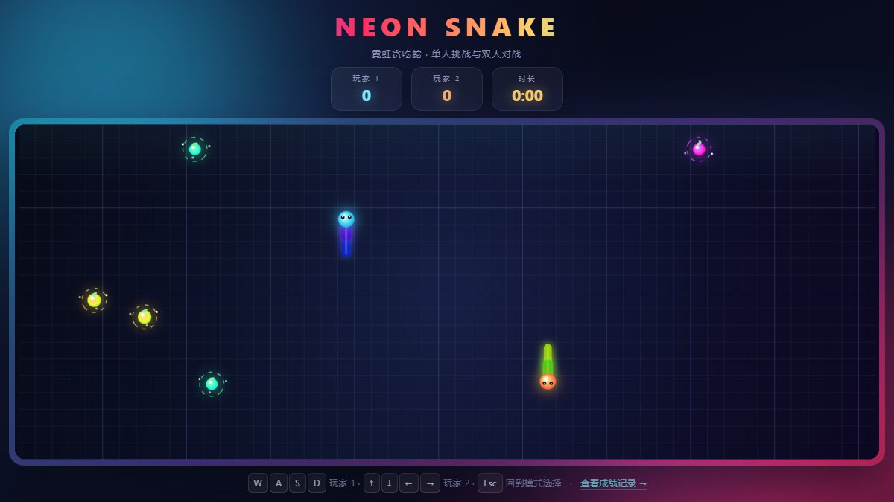

  <picture>
    <source media="(prefers-color-scheme: dark)" srcset="./assets/hero-dark.svg">
    
  </picture>

  
  

## About

I am a Ph.D. student at the Institute of Automation, Chinese Academy of Sciences, based in Beijing.
My interests span reinforcement learning, large language models, intelligent agents, evolutionary
computation, automated algorithm design, and AI for Science.

## Research Map

  <picture>
    <source media="(prefers-color-scheme: dark)" srcset="./assets/research-map-dark.svg">
    
  </picture>

## Selected Projects

<table>
  <tr>
    <td width="50%" valign="top">
      
      <h3><a href="https://github.com/UCAS-yangxb/snake">Snake</a></h3>
      

        A neon browser game with single-player and local two-player modes, persistent score history,
        and GitHub Pages and Docker deployment.
      

      
<code>HTML</code> <code>CSS</code> <code>JavaScript</code>

      

        <a href="https://ucas-yangxb.github.io/snake/">Play online</a> ·
        <a href="https://github.com/UCAS-yangxb/snake">Source</a>
      

    </td>
    <td width="50%" valign="top">
      
      <h3><a href="https://github.com/UCAS-yangxb/neon-breaker">Neon Breaker</a></h3>
      

        A zero-dependency Breakout game with custom physics, five levels, power-ups, local two-player
        mode, procedural audio, and automated smoke tests.
      

      
<code>Canvas</code> <code>JavaScript</code> <code>Web Audio</code>

      
<a href="https://github.com/UCAS-yangxb/neon-breaker">View source</a>

    </td>
  </tr>
</table>

## GitHub Activity

  <picture>
    <source
      media="(prefers-color-scheme: dark)"
      srcset="https://github-readme-stats.vercel.app/api?username=UCAS-yangxb&show_icons=true&rank_icon=github&hide_border=true&card_width=390&title_color=5eead4&icon_color=a78bfa&text_color=cbd5e1&bg_color=00000000"
    >
    
  </picture>
  <picture>
    <source
      media="(prefers-color-scheme: dark)"
      srcset="https://github-readme-stats.vercel.app/api/top-langs/?username=UCAS-yangxb&layout=compact&langs_count=6&hide_border=true&card_width=390&title_color=5eead4&text_color=cbd5e1&bg_color=00000000"
    >
    
  </picture>

## Contributions

  <picture>
    <source
      media="(prefers-color-scheme: dark)"
      srcset="https://raw.githubusercontent.com/UCAS-yangxb/UCAS-yangxb/output/github-snake-dark.svg"
    >
    
  </picture>

## Toolbox

`Python` · `Jupyter` · `Git` · `HTML` · `CSS` · `JavaScript`

## Connect

- GitHub: [@UCAS-yangxb](https://github.com/UCAS-yangxb)
- ORCID: [0009-0007-6413-9414](https://orcid.org/0009-0007-6413-9414)

---

Thanks for stopping by.

