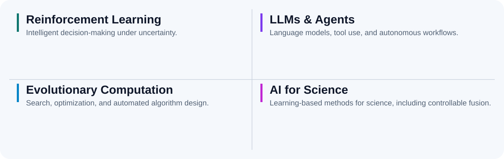
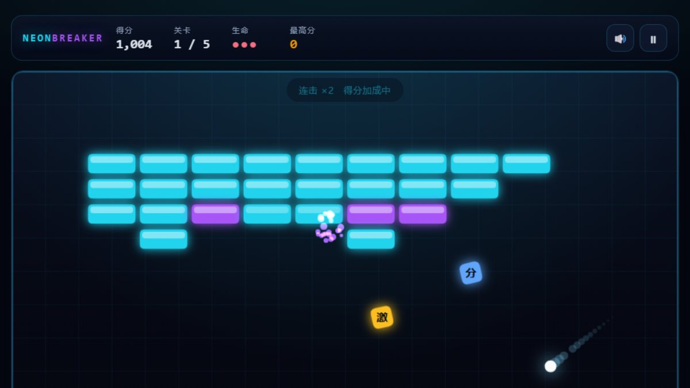

  <picture>
    <source media="(prefers-color-scheme: dark)" srcset="./assets/hero-dark.svg">
    
  </picture>

  
  

## About

I am a final-year undergraduate student at the University of Chinese Academy of Sciences (UCAS)
and an incoming direct-entry Ph.D. student at the Institute of Automation, Chinese Academy of
Sciences (CASIA), based in Beijing.

I am currently building a foundation in reinforcement learning, large language models, intelligent
agents, evolutionary computation, automated algorithm design, and AI for Science.

## Research Map

  <picture>
    <source media="(prefers-color-scheme: dark)" srcset="./assets/research-map-dark.svg">
    
  </picture>

## Selected Projects

Small projects I use to strengthen my engineering workflow and turn ideas into working software.

<table>
  <tr>
    <td width="50%" valign="top">
      
      <h3><a href="https://github.com/UCAS-yangxb/snake">Snake</a></h3>
      

        A neon browser game with single-player and local two-player modes, persistent score history,
        and GitHub Pages and Docker deployment.
      

      
<code>HTML</code> <code>CSS</code> <code>JavaScript</code>

      

        <a href="https://ucas-yangxb.github.io/snake/">Play online</a> ·
        <a href="https://github.com/UCAS-yangxb/snake">Source</a>
      

    </td>
    <td width="50%" valign="top">
      
      <h3><a href="https://github.com/UCAS-yangxb/neon-breaker">Neon Breaker</a></h3>
      

        A zero-dependency Breakout game with custom physics, five levels, power-ups, local two-player
        mode, procedural audio, and automated smoke tests.
      

      
<code>Canvas</code> <code>JavaScript</code> <code>Web Audio</code>

      
<a href="https://github.com/UCAS-yangxb/neon-breaker">View source</a>

    </td>
  </tr>
</table>

## Contributions

  <picture>
    <source
      media="(prefers-color-scheme: dark)"
      srcset="https://raw.githubusercontent.com/UCAS-yangxb/UCAS-yangxb/output/github-snake-dark.svg"
    >
    
  </picture>

## Toolbox

`Python` · `Jupyter` · `Git` · `HTML` · `CSS` · `JavaScript`

## Connect

- GitHub: [@UCAS-yangxb](https://github.com/UCAS-yangxb)
- ORCID: [0009-0007-6413-9414](https://orcid.org/0009-0007-6413-9414)

---

Thanks for stopping by.

